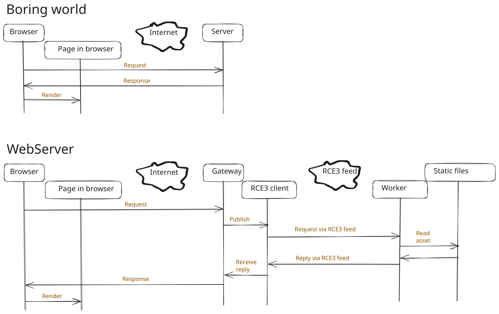

# WebServer

WebServer is a .NET 10 example that serves a static site through an RCE3 feed. The browser talks to the HTTP gateway. A separate hosting worker reads the bundled files and sends replies over the same feed using outbound HTTP connections.

<p align="center"></p>

## Run locally

From the repository root, start FeedServer in one terminal.

```powershell
dotnet run --project src/FeedServer/FeedServer/FeedServer.csproj --no-launch-profile
```

Choose a new GUID for the feed. Set the same full URL in the two terminals that will run WebServer. Replace the example GUID with yours.

```powershell
$env:RCE3_FEED = "http://127.0.0.1:5137/00000000-0000-0000-0000-000000000000"
```

For an open feed, leave `RCE3_AUTH` unset or empty. For a protected feed, set `RCE3_AUTH` to the same raw Authorization value in both terminals before either reader starts. Use a dedicated feed shared only with trusted participants. Anyone with feed access can read requests and responses and publish their own. The feed key controls access to the feed itself. The gateway serves the demo to anyone who can reach its listener.

In the second terminal, start the hosting worker and wait for `Reader ready.`

```powershell
dotnet run --project src/Examples/WebServer/WebServer.Host/WebServer.Host.csproj
```

In the third terminal, start the gateway and wait for `Reader ready.` and the listening address.

```powershell
dotnet run --project src/Examples/WebServer/WebServer.Gateway/WebServer.Gateway.csproj
```

Open [http://127.0.0.1:5139](http://127.0.0.1:5139). The page, stylesheet, and diagram each go through the relay. To change the gateway address with `dotnet run`, append `-- --urls <address>`.

## Publish

```powershell
dotnet publish src/Examples/WebServer/WebServer.Host/WebServer.Host.csproj -c Release
dotnet publish src/Examples/WebServer/WebServer.Gateway/WebServer.Gateway.csproj -c Release
```

From each project's publish directory, run `dotnet WebServer.Host.dll` or `dotnet WebServer.Gateway.dll`. Both use the ASP.NET Core 10 runtime. Keep the worker's `www` directory beside its DLL.

Locally, each project saves its reader ID beside its executable in `host/readerid` or `gateway/readerid`. Copy the corresponding file when moving an existing installation to a new directory. Run one process per role on the feed. Both roles reset their own queues at startup and after overflow.

## Publish the gateway to Azure App Service

In Visual Studio, open `WebServer.slnx` and publish the **WebServer.Gateway** project to a .NET 10 App Service using the standard Azure publish profile. The gateway has its own entry point and starts with no role argument, custom startup command, or IIS transform.

Set `RCE3_FEED` in the App Service's application settings to the full feed URL reachable from Azure. For a protected feed, set `RCE3_AUTH` to the same raw key the worker uses. Run **WebServer.Host** where the files live and point it at the same feed.

Use one gateway instance for this example. On App Service the gateway saves its reader ID under `HOME/data/WebServer/gateway/readerid`, outside the deployed package. When moving an existing gateway to App Service, copy its reader ID there before starting the new deployment.

## Relay behavior

The worker serves files under the `www` directory beside `WebServer.Host.dll`. Replace or add files in `WebServer.Host/www` before publishing, or edit the deployed worker's `www` directory directly. The project includes nested files automatically when it builds and publishes.

The gateway relays `GET` and `HEAD` by path. For example, `/static/js/app.js?v=2` serves `www/static/js/app.js`. The root path `/` serves `www/index.html`. The worker selects the content type by file extension and returns `404` for missing files, directory paths, and paths containing traversal segments or symbolic links.

Assets are limited to 750 KiB and serialized feed messages to 1 MiB. Request and reply JSON is scoped to this example and correlated by a GUID. The RCE3 feed carries the message bodies with their supplied media types.

The gateway returns `503` while its feed reader is unavailable or 32 requests are already in flight, `502` if publication fails or the reader is interrupted, and `504` if a request hits its 10-second deadline. Start both roles before browsing. Requests sent before the worker has a reader are lost, and the gateway does not replay requests after a failure.

## Tests

Run `dotnet test src/Examples/WebServer/WebServer.slnx` from the repository root.
